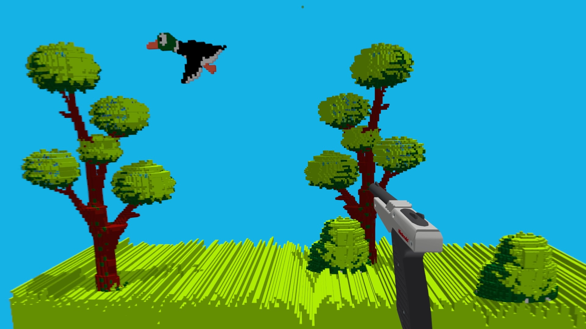

# RetroArch for Apple Vision Pro

A native **visionOS** build of [RetroArch](https://www.retroarch.com), the
libretro emulator frontend, with thirteen cores built in and a **3dSen-style
3D mode** that turns NES games into dioramas floating in your room, rendered
with real stereo depth.

Not affiliated with libretro, Geod (3dSen), Nintendo, Sega, Sony, or Atari.
This app ships **no games, no BIOS files and no 3D profiles**. You bring your own.

---

## Install

**Add the SideStore source** and RetroArch auto-updates when new versions ship:

| Device | Source | Source URL |
| --- | --- | --- |
| Apple Vision Pro | All ports | `https://raw.githubusercontent.com/rebelancap/all-ports/main/apps-visionos.json` |

On **Apple Vision Pro**, first install SideStore onto the headset with
[iloader](https://github.com/rebelancap/iloader/releases#release-visionos)
(SideStore/AltStore can't be installed on visionOS the usual way). Then in
SideStore: *Sources → **+** → paste the URL*, then install RetroArch.

**Prefer a manual install?** Download `RetroArch-1.23.0-visionOS.ipa` from the
[latest release](../../releases/latest) and install it through SideStore.

Requires **visionOS 26** or newer. The app is about 100 MB to download and
350 MB installed.

## Systems

All cores are compiled in and signed with the app. **No core can be downloaded
at runtime** (sideloaded apps can only load code signed with their own
certificate), so adding a system means a new release.

| System | Core | Notes |
| --- | --- | --- |
| NES / Famicom | Mesen | **3D mode** (see below), Zapper via controller aim |
| SNES | Snes9x, bsnes-hd beta | bsnes-hd adds HD Mode 7 |
| Nintendo 64 | Mupen64Plus-Next | OpenGL via ANGLE on Metal; interpreter only, so demanding games may not hold full speed |
| Game Boy / Color / Advance | mGBA | |
| Nintendo DS | melonDS | Software renderer, built-in FreeBIOS; some games want the real BIOS |
| Virtual Boy | Beetle VB | Anaglyph by default; native stereo is planned |
| Genesis / Mega Drive, Master System, Game Gear, Sega CD | Genesis Plus GX | Sega CD needs its BIOS |
| PlayStation | PCSX-ReARMed | Software GPU, interpreter; runs without a BIOS (HLE) |
| PC Engine / TurboGrafx-16 | Beetle PCE Fast | CD games need `syscard3.pce` |
| Atari 2600 | Stella 2014 | |
| DOS | DOSBox Pure | Interpreter only; load a `.zip` or a folder |
| Arcade | MAME 2003-Plus | ROM sets must match the MAME 0.78 set |

Every core here runs **without JIT**. Nothing needs a debugger or a JIT
enabler attached; it just runs.

## Your files

Open the **Files** app → *On My Apple Vision Pro* → **RetroArch**. Everything
lives under `RetroArch/`:

| Folder | What goes there |
| --- | --- |
| `ROMs/` (or anywhere you like) | Your game files. Load them from RetroArch's *Load Content* |
| `system/` | BIOS files (table below) |
| `system/3dsen/` | 3dSen `.3dn` profiles and `3dsen.cfg` (see 3D mode) |
| `saves/`, `states/` | SRAM and save states |
| `config/` | `retroarch.cfg` and per-core overrides |

BIOS files, exact lower-case names, in `RetroArch/system/`:

| System | Files | Required? |
| --- | --- | --- |
| Sega CD | `bios_CD_U.bin`, `bios_CD_E.bin`, `bios_CD_J.bin` | Yes |
| PC Engine CD | `syscard3.pce` | Yes, for CD games |
| PlayStation | `scph5501.bin` (US), `scph5500.bin` (JP), `scph5502.bin` (EU) | No; improves compatibility |
| Nintendo DS | `bios7.bin`, `bios9.bin`, `firmware.bin` | No; a few games need them |
| Game Boy Advance | `gba_bios.bin` | No |

## Controllers

Any Bluetooth gamepad Apple Vision Pro supports (Xbox, PlayStation, Backbone,
8BitDo in Xbox mode). The pad drives the emulator directly; the system's
gaze-and-pinch pointer is reserved for the menus. Standard RetroArch bindings
apply, and the RetroArch menu opens with the usual hotkey combination
(configurable under *Settings → Input → Hotkeys*).

## 3D mode (NES)

Load an NES game and tap the **3D** ornament beside the window. The game
leaves the flat window and becomes a 3D diorama in your room, the way
[3dSen](https://geod.itch.io/3dsen-vr) does it: every background tile and
sprite is given depth and shape by a per-game **profile**, lit and shadowed,
viewed from a camera you steer.



| Control | Action |
| --- | --- |
| Right stick | Orbit the camera (yaw / pitch) |
| Right trigger / left trigger | Zoom in / out |
| Right stick click | Reset the view |
| **3D** ornament again | Back to the flat window |

The camera is remembered per game. Your hands are hidden while in 3D so they
don't cover the scene (`hands = 1` in `3dsen.cfg` shows them again).

**Light gun.** When **PlayStation VR2 Sense controllers** are paired to the
headset, Duck Hunt selects the Zapper on port 2 automatically: aim a controller
at the scene and pull the trigger to fire. Other light-gun games can set it
manually under *Quick Menu → Controls → Port 2 → Device Type → Zapper*. A virtual
Zapper is drawn in your hand and there is no reticle by default, so you aim by
eye as on the original (`reticle = 1` in `system/zapper.cfg` brings it back). The in-hand
Zapper is Max Keeley's ['Nintendo Zapper Gun Model'](https://sketchfab.com/3d-models/nintendo-zapper-gun-model-dd59e968979b46b3a4f8e151c7de37fe)
(CC BY 4.0), recoloured to the 1985 grey. If it sits wrong in your hand, nudge
it with `gun_up`, `gun_right` and `gun_forward` (metres; defaults `0.045`,
`0.012`, `-0.02`) in `system/zapper.cfg`.

### Profiles: you bring them, the app reads them

3D mode needs a **3dSen profile** (`.3dn` file) for the game. **This app ships
none.** The profile format and its Lua scripting are read by our own code, so
any `.3dn` works:

- **Community profiles.** Fans share profiles on the
  [3dSen Maker community board](https://geod.itch.io/3dsen-maker/community)
  and the Geod Discord. Download the `.3dn`, drop it in `RetroArch/system/3dsen/`.
- **Your own.** [3dSen Maker](https://geod.itch.io/3dsen-maker) is Geod's
  free profile editor. Profiles you make there are plain `.3dn` files.
- **3dSen's bundled profiles.** If you own 3dSen, you can copy its ~100
  official profiles out of your own install. See the next section.

Profiles are matched to the game by **content**, not file name: the app
compares the profile's tile patterns against the ROM, so renamed ROMs and
regional variants still match. Naming the file after the ROM works too. With
no profile the game simply stays in the flat window.

Both 3dSen v1 and v2 profile files work, including v2's Lua camera scripts
(Punch-Out!!'s ringside camera, for example).

### Copying the profiles from your 3dSen install

3dSenVR (Steam, Windows) and 3dSen PC keep their official profiles in one file
inside the game's install, `defaultprofiles_<long id>.bundle`, in a folder under
`StreamingAssets`. The script `scripts/3dsen-extract-profiles.py` in this repo
reads that file and writes each profile out as a `.3dn`. It works on Windows
and on macOS: it only needs Python 3 and the game's own files, nothing is
downloaded. You must own the game. We do not redistribute the profiles.

1. **Find the install folder.** In Steam: right-click the game → *Manage* →
   *Browse local files*. The usual places are:
   - Windows, 3dSenVR: `C:\Program Files (x86)\Steam\steamapps\common\3dSenVR`
     (the bundle is in `3dSenVR_Data\StreamingAssets\aa\StandaloneWindows64\`).
   - macOS: `~/Library/Application Support/Steam/steamapps/common/<game>/`; the
     bundle is inside the `.app`, under `Contents/Resources/Data/StreamingAssets/`.

   You do not need the exact sub-folder: give the script the install folder,
   the `.app`, the `StreamingAssets` folder or the `.bundle` itself, and it
   searches everything below for the bundle. 3dSenVR is Windows-only; to
   extract on a Mac, copy the `.bundle` file over and point the script at it.
2. **Get the script.** Download this repo (*Code* → *Download ZIP*) and unzip it,
   then open a terminal in that folder (Windows: *Command Prompt*; macOS:
   *Terminal*).
3. **Install Python 3** if you do not have it (Windows: from python.org or the
   Microsoft Store; macOS: python.org or `xcode-select --install`), then the one
   library the script uses, and run it:

   Windows:
   ```
   py -m pip install UnityPy
   py scripts\3dsen-extract-profiles.py "C:\Program Files (x86)\Steam\steamapps\common\3dSenVR" "%USERPROFILE%\Desktop\3dsen"
   ```
   macOS:
   ```
   python3 -m pip install UnityPy
   python3 scripts/3dsen-extract-profiles.py "<install folder>" ~/Desktop/3dsen
   ```
   It prints the bundle it found and how many profiles it wrote (about 100).
4. **Copy the `.3dn` files to the headset**, into `RetroArch/system/3dsen/`:
   AirDrop or iCloud Drive to the Vision Pro, then move them there with the
   Files app (*On My Apple Vision Pro → RetroArch → RetroArch → system → 3dsen*).

### Tuning (`system/3dsen/3dsen.cfg`)

Optional, one `key = value` per line, read when you enter 3D. All defaults
follow 3dSenVR v2; the "Enhanced" effects are off by default because they cost
real GPU time on the headset.

| Key | Default | What it does |
| --- | --- | --- |
| `retina` | `0` | `1` = smooth-faceted ("Retina") meshing; `0` = classic blocks |
| `msaa` | `4` | Edge anti-aliasing: `0`, `2` or `4` |
| `zoom_default` | `1.25` | How close the diorama sits when a game opens |
| `pixel_shadow` | `0` | Per-pixel stepped shadows |
| `groove` | `0` | Voxel grooves on faces: `2`, `4` or `8` |
| `bend_lr`, `bend_tb` | `0` | World curvature in degrees (try `30`) |
| `ao` | `0` | Depth ambient occlusion (contact shading) |
| `reflection` | `0` | Screen-space reflections on floors |
| `runahead` | `0` | Run one frame ahead for lower input latency (about 2× CPU) |
| `camera_persist` | `1` | Remember the camera per game |
| `hands` | `0` | `1` shows your hands in 3D mode |
| `camera_orbit_speed` | `30` | Orbit speed, degrees per second |
| `camera_swap_zoom` | `0` | `1` swaps the zoom triggers |
| `camera_invert_y` | `0` | Invert pitch |

## Building

```
scripts/bootstrap.sh            # clones RetroArch and the 13 cores at pinned commits
scripts/apply-overlay.sh        # applies our patches on top (upstream stays pristine)
scripts/build-core-xros.sh      # builds the cores for visionOS (device) — add `sim` for the simulator
scripts/build-visionos-app.sh   # builds and signs RetroArch.app
```

Upstream RetroArch and every core are **vendored by commit and left untouched**;
all our changes are patches under `overlay/patches/`, generated by the
`scripts/gen-patch-*.py` scripts. Our visionOS shell, the 3D renderer and the
profile reader live in `app/visionos/`.

## Licence and credits

RetroArch is GPLv3; this repository's changes are GPLv3 as well. Cores keep
their own licences (Snes9x and MAME 2003-Plus are non-commercial; most others are
GPL). ANGLE is BSD; MoltenVK is Apache 2.0. The 3D mode is our own
implementation of the 3dSen idea: it contains none of Geod's code or assets and
reads the `.3dn` profile format so that existing profiles work. 3dSen and the
`.3dn` format are Geod's work; go buy
[3dSenVR](https://store.steampowered.com/app/954280/). The in-hand Zapper model is Max Keeley's
"Nintendo Zapper Gun Model", CC BY 4.0, recoloured and simplified
(`app/visionos/assets/LICENSE-zapper-model.md`).
